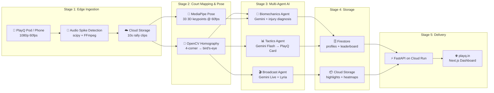

# 🏓 PlayQ — Build Plan & Sprint Tracker

> AI-powered Full HD 60fps broadcast highlights, spatial analytics & biomechanical intelligence for recreational sports

## Architecture Overview



## Current Build Status — Day 1 code + first real-clip test (2026-11-17)

| Module | File | Status |
|--------|------|--------|
| 📐 Court Homography | `playq/cv/homography.py` | ✅ Landmark-based calibration + `CameraStabilizer` (handles handheld drift) |
| 👥 Player Tracker | `playq/cv/tracker.py`, `playq/cv/movement.py` | ✅ ID lock (jersey histogram + court position + no-net-crossing rule), far-court ROI pass. Unvalidated vs ground truth |
| 🦴 Pose Analyzer | `playq/cv/pose_analyzer.py` | ⚠️ Math fixed (pixel space, frontal-plane valgus gate, trunk lean, event grouping). **Not clinically validated** |
| 🎵 Rally Detector | `playq/cv/rally_detector.py` | ✅ Transient-based (adaptive), uses bundled ffmpeg. Found the real 30 s rally in the test clip |
| ⭐ Rating Engine | `playq/models/rating.py` | ✅ Pitch attributes (Court Coverage, Shot Consistency, Attack Aggression, Stamina, Clutch Factor). Coverage/Aggression/Stamina measured from tracking; Consistency/Clutch are flagged placeholders until Gemini/score tracking |
| 🌐 FastAPI Backend | `playq/api/main.py` | ✅ Imports; not yet wired to the real video pipeline |
| 🤖 Gemini Agents | `playq/agents/gemini_agents.py`, `schemas.py` | ⚠️ 4 agents, Pydantic structured output, video verification. **Wired but untested against the live API** (no key yet). Model default `gemini-3.8-flash` (2.0 shut down, 2.5 deprecated) |
| 🎬 Real-video pipeline | `scripts/analyze_video.py` | ✅ Runs end-to-end on `VID_20261116_213210350.mp4` in ~25 s |
| 🔧 Calibration check | `scripts/verify_calibration.py`, `config/court_calibration.json` | ✅ Overlay to eyeball the homography |

### What the first real clip (1080p, 60 fps, 66 s) taught us
1. **Original numbers were wrong.** Peak "knee valgus 143°" and 149/165 "high-risk" frames came from computing angles on normalised 0-1 coords (aspect-ratio distorted) and calling knee *flexion* "valgus". Fixed.
2. **Knee valgus is not measurable from a side-on camera.** Median shoulder/torso ratio was 0.19; only ~6 frames had a frontal view. Pod mounting guidance: behind the baseline, centred.
3. **Camera drifted** (handheld) → one fixed homography put the heatmap in the wrong place. The production pod is fixed, but add stabilisation anyway (done).
4. **Fixed dB threshold found zero rallies** (loudest 5 % ≈ -22 dB vs -20 dB default). Replaced with transient detection above a rolling noise floor.
5. **Remaining false positives**: partly cut-off player at frame edge gives scattered landmarks (e.g. 73° "trunk lean" on an upright stance at 18.3 s). MediaPipe reports high visibility on these, so it needs ground-truth review, not another threshold.
6. **Speed**: `pose_landmarker_full` took 547 s vs 15 s for `lite` on CPU. The pitch's "<90 s per 45-min match" needs GPU/Cloud Run sizing or sparser sampling.

> [!NOTE]
> Free-tier Gemini API content may be used to improve Google products. Use paid tier (billing on) before sending real customer videos.

> [!WARNING]
> The pitch claims "90% angle accuracy" and "92% ID lock". Neither is measured yet. Before the Nov 20–21 demo, label a few clips by hand (or with a physio) and report real numbers.

## Pitch deck vs. what exists

| Pitch promise | State |
|---|---|
| 5 attributes: Court Coverage, Shot Consistency, Attack Aggression, Stamina, Clutch Factor | ✅ Renamed; 2 of 5 still placeholders |
| 92 % player ID lock (jersey histogram + handedness) | ⚠️ Built (tracker); not yet measured against labelled data |
| Gemma edge occupancy gate | ❌ Not built |
| Gemini Omni rally verification | ❌ Audio-only so far |
| Nano Banana posture overlays / rating card art | ❌ Posture frames drawn with OpenCV only |
| Lyria + Gemini Live Hinglish reel, 9:16 | ⚠️ `trim_clip(vertical=True)` exists; no commentary/music |
| Nemesis head-to-head dossier | ❌ |
| Mini-VAR in/out replay | ❌ |
| WhatsApp delivery, QR flow | ❌ |
| 4-agent Antigravity pipeline | ⚠️ 4 Gemini agents exist; not Antigravity-orchestrated |

## 7-Day Sprint Plan

### Day 1 (Today) — Foundation ✅
- [x] Project scaffold & dependency setup
- [x] Core CV modules (homography, pose, rally)
- [x] Data models & rating engine
- [x] FastAPI backend skeleton
- [x] Multi-agent Gemini integration
- [x] Run demo pipeline with synthetic data
- [x] Run pipeline on first real clip (see findings above)

### Day 2-3 — Real Video Processing (re-prioritised)
- [ ] Mount camera on a fixed tripod behind the baseline, centred; re-record (needed for valgus)
- [ ] Hand-label ~20 moments → measure real angle accuracy & false-positive rate
- [x] Player tracking / ID lock (needs validation)
- [x] Rename rating attributes to match the pitch deck
- [ ] Record 3 test clips (pickleball rally, unforced error, deep lunge)
- [ ] Test homography calibration with real court footage
- [ ] Validate MediaPipe pose extraction on 60fps clips
- [ ] Tune rally detection audio thresholds per sport
- [x] ffmpeg: bundled via `imageio-ffmpeg` (no brew needed)

### Day 4-5 — AI Agent Integration
- [ ] Connect Google AI Studio API key → `cp .env.example .env`, then `python scripts/test_gemini.py` (see README/notes)
- [ ] Test Gemini Flash structured JSON output
- [ ] Build Antigravity custom skills from CV functions
- [ ] End-to-end pipeline: video → analysis → PlayQ Card
- [ ] Test Gemini Omni video reasoning on rally clips

### Day 6-7 — Dashboard & Deploy
- [ ] Dark-mode Next.js frontend (`playq.in`)
- [ ] Interactive 2D heatmap component
- [ ] FIFA-style PlayQ Rating Card UI
- [ ] Posture audit overlay viewer
- [ ] Deploy FastAPI to Cloud Run
- [ ] Deploy frontend to Vercel

## Tech Stack

| Layer | Technology | Cost |
|-------|-----------|------|
| CV Pipeline | OpenCV, MediaPipe, scipy, FFmpeg | Free (OSS) |
| AI Reasoning | Gemini Flash / Omni via AI Studio | Free tier |
| Agent Framework | Google Antigravity + Agent Skills | Included in AI Pro |
| Backend | FastAPI on Cloud Run | Free tier (2M req/mo) |
| Database | Cloud Firestore | Free tier (1 GiB) |
| Storage | Google Cloud Storage | Free tier (5 GB) |
| Frontend | Next.js on Vercel | Free tier |
| Media | Nano Banana, Lyria (API) | ~₹100 for demos |

## Project Structure

```
PlayQ/
├── main.py                    # Entry point (uvicorn)
├── pyproject.toml             # Project config & deps
├── README.md
├── .gitignore
├── playq/
│   ├── __init__.py
│   ├── cv/
│   │   ├── __init__.py
│   │   ├── homography.py      # Court perspective → 2D map
│   │   ├── pose_analyzer.py   # MediaPipe skeletal analysis
│   │   └── rally_detector.py  # Audio spike → clip trimming
│   ├── models/
│   │   ├── __init__.py
│   │   └── rating.py          # PlayQ Rating & data models
│   ├── agents/
│   │   ├── __init__.py
│   │   └── gemini_agents.py   # Multi-agent Gemini system
│   ├── skills/
│   │   └── __init__.py
│   └── api/
│       ├── __init__.py
│       └── main.py            # FastAPI endpoints
├── scripts/
│   └── demo_pipeline.py       # Synthetic data demo
├── tests/
├── config/
├── frontend/
├── docs/
└── data/
    └── sample_clips/
```

> [!IMPORTANT]
> **Next steps after build completes:** Run the demo pipeline, then record your first 3 test clips at a local pickleball court or turf.
